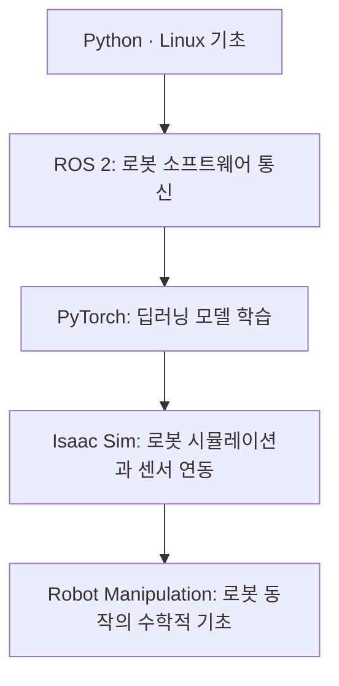

# Physical AI Study Log

**Physical AI 소프트웨어 개발을 목표로 로봇 미들웨어, 딥러닝 프레임워크, 로봇 시뮬레이션 및 로봇 동작의 기초를 학습한 기록입니다.**

이 저장소는 학습한 내용을 단순히 모아두는 데 그치지 않고, 각 기술을 어떤 순서로 공부했고 무엇을 직접 다뤄 보았으며, 실습 중 어떤 문제를 발견하고 다음 학습 주제로 연결했는지 보여주기 위해 정리했습니다.

> **학습 기록 기간:** 2026.07.01 – 2026.08.18  
> **구성:** 날짜별 학습 로그 49개 · 주제별 학습 노트 6개 · ROS 2 실습 1개

---

## 1. 학습 방향과 전체 흐름

Physical AI를 이해하려면 AI 모델 자체뿐 아니라, 모델이 로봇 시스템과 연결되는 과정도 함께 이해해야 한다고 생각했습니다. 이에 따라 **로봇 소프트웨어의 통신 구조 → 딥러닝 모델의 학습 과정 → 시뮬레이션 환경에서의 로봇·센서 연동 → 로봇의 움직임을 설명하는 수학적 기초** 순서로 학습 범위를 넓혔습니다.



각 단계에서 중점적으로 확인한 내용은 다음과 같습니다.

| 단계 | 학습한 이유 | 핵심 학습 내용 |
|---|---|---|
| **Python · Linux** | ROS 2와 AI 도구를 다루기 위한 개발 환경 및 언어 기초 확보 | Python 자료형·제어문·함수·클래스·예외 처리, Linux 터미널, 개발 환경 구성 |
| **ROS 2** | 로봇의 기능을 노드 단위로 구성하고 데이터와 명령을 주고받는 방법 이해 | Node, Topic, Service, Action, Python API, 패키지 생성·빌드, Parameter, Log |
| **PyTorch** | AI 모델이 데이터를 처리하고 오차를 바탕으로 학습하는 원리 이해 | Tensor, Autograd, 역전파, Dataset·DataLoader, 신경망 Layer, Loss, Optimizer, 학습 지표 |
| **NVIDIA Isaac Sim** | 가상 환경에서 로봇과 센서를 구성하고 ROS 2 및 Python으로 제어하는 방법 이해 | USD·Prim, 물리·관절 설정, Action Graph, ROS 2 Bridge, Camera·LiDAR, TF·Odometry, Navigation |
| **Robot Manipulation** | AI가 로봇의 동작을 다루기 위해 필요한 공간·자세 표현의 기초 이해 | Configuration, DOF, C-space, Task Space, Workspace, 회전 행렬, 강체 운동 |

---

## 2. 주요 학습 내용

### 2.1. ROS 2 — 로봇 소프트웨어의 통신 구조 이해

처음에는 ROS 2 기반의 로봇 소프트웨어를 이해하는 것을 목표로 삼았습니다. Python과 Linux 사용법을 복습한 뒤, ROS 2의 기본 통신 구조를 학습하고 Python 코드로 직접 노드를 작성하는 단계까지 진행했습니다.

**주요 학습 내용**

- **통신 구조:** Node, Publisher / Subscriber, Topic, Service, Action의 차이와 사용 목적
- **Python 기반 구현:** `rclpy`를 이용한 토픽 발행·구독, 서비스 요청·응답, 액션 서버·클라이언트 구현
- **패키지와 실행 환경:** ROS 2 패키지 구조, `ament_python` 패키지 생성, `colcon build`, 파라미터와 로그 관리
- **통신 흐름 확인:** ROS 2 명령어와 `rqt_graph` 등을 활용한 노드 및 통신 관계 확인

**실습 — TurtleSim으로 하트 그리기**

ROS 2의 Topic과 Service를 실제로 사용해 보기 위해 turtlesim의 거북이가 이동하며 하트 궤적을 그리도록 구성했습니다. 하트의 궤적을 구간별 직선과 회전으로 나누어 이동 거리와 회전 각도를 계산하고, `/turtle1/cmd_vel` 토픽으로 속도 명령을 전달했습니다. 시작 위치와 방향 설정에는 Service를 사용했습니다.

- [실습 설명 및 실행 환경](./Practice/Robot%20Operating%20System%202/Drawing%20a%20Heart/README.md)
- [Jupyter Notebook 코드](./Practice/Robot%20Operating%20System%202/Drawing%20a%20Heart/Code/Drawing_Heart%20Jupyter.ipynb)
- [터미널 명령 코드](./Practice/Robot%20Operating%20System%202/Drawing%20a%20Heart/Code/Drawing_Heart%20Terminal.md)

<details>
<summary><strong>실습 결과 보기 — TurtleSim Heart</strong></summary>


</details>

이 실습을 통해 Topic과 Service가 단순히 다른 문법이 아니라, **지속적으로 전달해야 하는 데이터와 요청에 따라 한 번 수행하는 작업이라는 목적에 따라 구분해 사용하는 통신 방식**임을 확인했습니다. 또한 로봇이 지원하는 자유도에 따라 실제로 반응하는 속도 명령이 달라진다는 점도 기록했습니다.

### 2.2. PyTorch — 딥러닝 모델의 학습 과정 이해

ROS 2 기초를 학습한 뒤에는 AI 모델이 데이터를 입력받아 결과를 만들고, 오차를 계산해 파라미터를 갱신하는 과정을 이해하는 데 집중했습니다. 강의의 코드를 따라 작성하는 데 그치지 않고 작은 모델을 직접 구성하고, 학습 중 발생한 문제를 찾아 원인을 정리하는 방식으로 진행했습니다.

**주요 학습 내용**

- **Tensor:** 생성, 자료형 및 디바이스 관리, 연산, 차원 변경과 결합
- **학습 원리:** Autograd, Computational Graph, Chain Rule, Backpropagation
- **데이터 처리:** Dataset, DataLoader, 이미지 전처리 및 Batch 구성
- **모델 구성:** `nn.Module`, Linear·Convolution·Pooling Layer, 활성화 함수
- **학습과 평가:** Loss Function, SGD·Adam 계열 Optimizer, Learning Rate Scheduler, Accuracy

**실습 및 학습 중 확인한 점**

- 임의의 입력 Tensor와 정답 Tensor를 사용해 간단한 모델을 구성하고 Loss를 줄이는 과정을 직접 실습했습니다.
- MNIST 데이터셋을 이용해 분류 모델을 직접 구성하고 학습했습니다.
- 학습 과정에서 동일한 Batch만 반복해서 사용하던 문제를 발견하고, Iterator 생성 위치를 수정해 원인을 해결했습니다.
- Learning Rate Scheduler가 의도보다 자주 실행되어 학습률이 빠르게 감소하던 문제를 확인하고, Epoch 단위 검증 결과와 스케줄러 실행 시점의 관계를 정리했습니다.
- VOCDetection 데이터셋을 살펴보며 이미지마다 객체 수와 Bounding Box 구성이 다를 때 Batch를 구성하는 방법(`collate_fn`)을 학습했습니다. 이 과정은 객체 탐지 모델 완성보다는 데이터 구조와 전처리 과정을 이해하는 데 초점을 두었습니다.

관련 개념과 코드는 [PyTorch 학습 노트](./Study%20Note/Pytorch.md)에 정리했습니다.

### 2.3. NVIDIA Isaac Sim — 시뮬레이션에서 로봇과 센서 연결하기

딥러닝 프레임워크의 학습 원리를 익힌 뒤에는 로봇이 동작하는 환경을 직접 구성하고, 시뮬레이션의 데이터와 ROS 2가 어떻게 연결되는지 학습했습니다. 단순히 화면에서 로봇을 움직이는 것보다 **로봇의 물리적 구성, 센서 데이터, ROS 2 통신, Python 제어 코드가 어떤 관계를 갖는지** 이해하는 데 중점을 두었습니다.

**주요 학습 내용**

- **시뮬레이션 구성:** USD, Prim, Mesh, Material, Physics Scene, Rigid Body, Joint
- **로봇 제어:** Action Graph, Differential Controller, Articulation Controller, Python Core API와 Callback
- **ROS 2 연동:** ROS 2 Bridge, `Twist` 구독, 시뮬레이션 데이터의 ROS 2 메시지 발행
- **센서 데이터:** Camera의 RGB·Depth 데이터와 LiDAR 데이터 발행 및 구독
- **로봇 상태 정보:** Simulation/System Time, TF Transform Tree, Odometry
- **환경 및 이동:** 정적 환경의 Occupancy Map 생성, Navigation의 기본 구성과 동작 절차

**실습 과정에서 다룬 내용**

- Isaac Sim의 TurtleBot3를 불러와 ROS 2 토픽으로 속도 명령을 전달하고, 로봇이 움직이지 않는 문제를 설정과 오류 로그를 확인하며 해결했습니다.
- 시뮬레이션 카메라의 RGB·Depth 데이터와 LiDAR 데이터를 ROS 2 토픽으로 발행하고 터미널에서 확인했습니다.
- Python API 예제를 통해 시뮬레이션 객체 생성, 물리 속성 적용, Callback 기반 제어를 실습했습니다.
- Franka 로봇으로 큐브를 집어 이동시키는 작업을 작은 목표로 설정하고 Python 제어 코드를 작성했습니다. 그 과정에서 그리퍼의 마찰계수, End-Effector의 이동 경로 및 자세 변화가 동작 결과에 미치는 영향을 관찰했습니다.

Isaac Sim 관련 인터페이스, Action Graph 노드, Python API 사용 내용은 [Isaac Sim 학습 노트](./Study%20Note/Isaac%20Sim.md)에 정리했습니다.

### 2.4. Robot Manipulation — 로봇의 움직임을 설명하는 수학적 기초

Franka의 End-Effector를 원하는 위치로 이동시키는 과정에서 명령한 위치와 실제 관절 움직임이 항상 직관적으로 일치하지 않는 상황을 경험했습니다. 이를 계기로 로봇의 동작을 수학적으로 표현하는 방법을 학습하기 시작했습니다.

**학습한 개념**

- **Configuration:** 로봇의 모든 점의 위치와 자세를 나타내는 상태
- **DOF (Degrees of Freedom):** 로봇의 Configuration을 표현하는 데 필요한 독립적인 자유도
- **C-space:** 로봇이 가질 수 있는 모든 Configuration의 공간
- **Task Space / Workspace:** 수행하려는 작업을 기준으로 한 공간과 로봇 구조가 도달할 수 있는 공간의 차이
- **Rigid-body motion:** 좌표계 사이의 관계를 회전 행렬과 위치 벡터로 표현하는 기초

이 과정에서 End-Effector의 목표 위치를 지정하는 것과 실제 관절의 움직임을 결정하는 문제 사이에 역기구학(Inverse Kinematics)이 연결된다는 점을 파악했고, 이를 후속 학습 주제로 정리했습니다.

관련 내용은 [Robot Manipulation 학습 노트](./Study%20Note/Robot%20Manipulation.md)에서 확인할 수 있습니다.

---

## 3. 저장소 구성

```text
Physical-AI-Study-Log/
├── README.md
├── Study Log/                 # 날짜별 학습 목표, 수행 내용, 배운 점, 회고 및 참고 자료
│   ├── 2026-07-01.md
│   ├── ...
│   └── 2026-08-18.md
├── Study Note/                # 주제별 개념 및 코드 정리
│   ├── Python.md
│   ├── Robot Operating System 2.md
│   ├── Pytorch.md
│   ├── Isaac Sim.md
│   ├── Robot Manipulation.md
│   └── Markdown.md
└── Practice/                  # 학습 내용을 직접 적용한 실습
    └── Robot Operating System 2/
        └── Drawing a Heart/
            ├── README.md
            ├── Code/
            └── Result Example/
```

| 폴더 | 용도 | 살펴볼 내용 |
|---|---|---|
| [`Study Log`](./Study%20Log/) | 날짜별 학습 흐름과 회고 | 그날의 목표, 실제로 수행한 내용, 새롭게 이해한 점, 문제와 해결 과정, 다음 학습 계획 |
| [`Study Note`](./Study%20Note/) | 주제별 지식 정리 | ROS 2 명령어·Python API, PyTorch 학습 구성 요소, Isaac Sim 개념과 노드, 로봇 동작 수학 |
| [`Practice`](./Practice/) | 직접 실행하거나 구성한 실습 | TurtleSim 하트 그리기의 설명, 코드, 결과 |

### 주요 학습 로그 바로가기

| 기간 | 학습 단계 | 관련 기록 |
|---|---|---|
| 07.01 – 07.14 | Python·Linux 기초 및 ROS 2 통신 구조·패키지 | [ROS 2 통신 실습](./Study%20Log/2026-07-07.md) · [Python 패키지와 Action](./Study%20Log/2026-07-13.md) |
| 07.15 – 07.23 | PyTorch 기초 및 모델 학습·MNIST 분류 | [역전파와 Tensor](./Study%20Log/2026-07-15.md) · [MNIST 분류 실습과 회고](./Study%20Log/2026-07-23.md) |
| 07.24 – 08.10 | Isaac Sim 환경 구성, 로봇·센서·ROS 2 연동 | [TurtleBot3와 ROS 2 연동](./Study%20Log/2026-07-29.md) · [Camera 데이터](./Study%20Log/2026-07-31.md) · [Occupancy Map과 Navigation](./Study%20Log/2026-08-04.md) |
| 08.11 – 08.18 | Robot Manipulation 기초 및 Franka 조작 | [Configuration과 좌표계](./Study%20Log/2026-08-12.md) · [Franka 조작과 문제 분석](./Study%20Log/2026-08-18.md) |

---

## 4. 학습 과정에서 중요하게 생각한 점

학습 과정에서 중요하게 기록한 것은 진도를 얼마나 나갔는지보다 **예상과 다른 결과가 나왔을 때 원인을 이해하고 다음 행동으로 연결하는 과정**입니다.

예를 들어 PyTorch 실습에서는 모델이 같은 Batch만 반복해서 학습하는 문제를 발견했고, Isaac Sim에서는 ROS 2 명령을 전달해도 로봇이 움직이지 않는 상황에서 오류 로그와 로봇 설정을 확인했습니다. Franka 조작 과정에서는 End-Effector를 한 번에 멀리 이동시키는 방식이 불안정할 수 있음을 관찰하고, 이동 경로와 역기구학의 관계를 다음 학습 주제로 연결했습니다.

각 날짜의 학습 로그에는 가능한 범위에서 목표, 수행 내용, 새롭게 이해한 점, 회고, 참고 자료를 기록했습니다. 따라서 주제별 노트가 **현재까지 정리한 지식**을 보여준다면, 날짜별 로그는 **그 지식에 도달하기까지의 과정과 문제 해결 방식**을 보여줍니다.

---

## 5. 현재 학습 범위와 다음 단계

이 저장소에서 확인할 수 있는 범위는 ROS 2, PyTorch, Isaac Sim의 기초 학습과 일부 시뮬레이션·모델 실습, 로봇 조작의 수학적 기초입니다. 아직 이 저장소에 **강화학습 기반 로봇 제어 또는 실제 이동 로봇의 자율주행을 완성한 결과물은 포함되어 있지 않습니다.**

앞으로는 개별 기술을 익히는 단계에서 나아가, 센서 데이터 입력부터 상태 표현, 의사결정, 로봇 제어까지 하나의 작은 과제로 연결하는 것을 목표로 하고 있습니다. 특히 로봇의 동작을 더 정확하게 다루기 위한 역기구학과, 학습 기반 제어를 실제 시뮬레이션 과제에 적용하는 방향으로 학습을 확장하고자 합니다.

---

## 6. 참고 자료 및 학습 환경

학습 과정에서 주로 참고한 자료는 다음과 같습니다.

- *ROS 2로 시작하는 로봇 프로그래밍*
- *ROS 2 혼자 공부하는 로봇 SW 직접 만들고 코딩하자*
- PyTorch Full Tutorial Course
- NVIDIA Isaac Sim Documentation 및 예제
- *Modern Robotics* 및 관련 강의

TurtleSim 하트 그리기 실습 환경은 **Ubuntu 24.04 / ROS 2 Jazzy / Python 3**입니다. Isaac Sim 학습 노트는 당시 사용한 **Isaac Sim 6.0.1**을 기준으로 작성했습니다.
